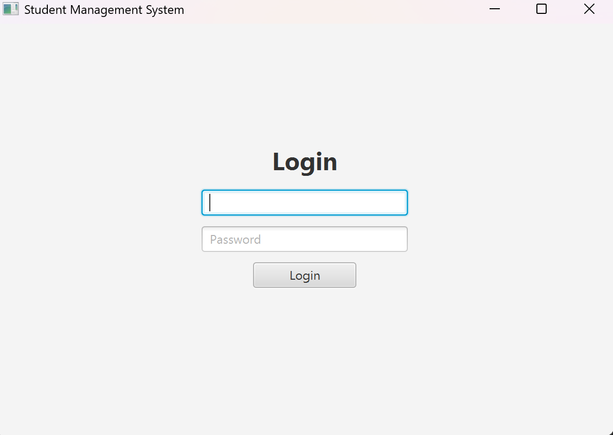
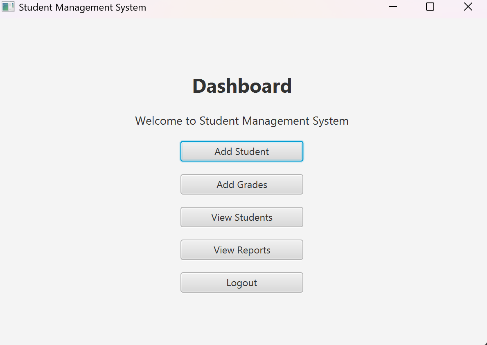
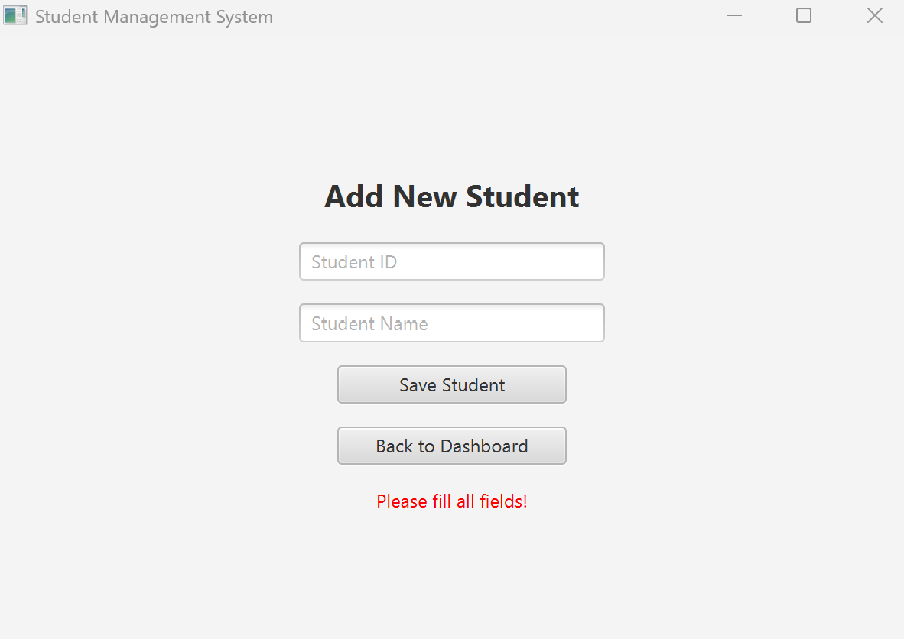
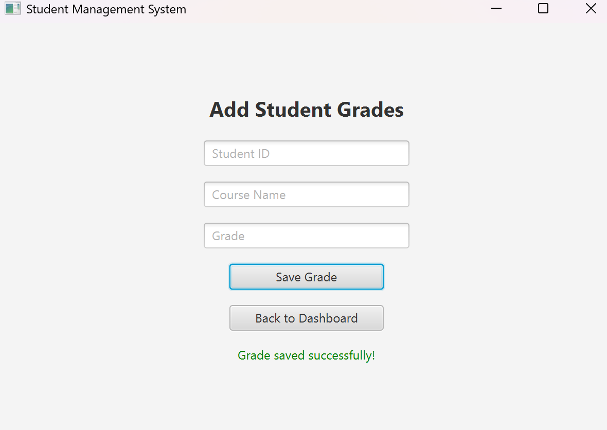

# Student and Grade Management System

A JavaFX desktop course project for Advanced Programming for CS (CS-4108), Umm Al-Qura University. The located implementation provides the six screens described in the course project brief: Login, Dashboard, Add Student, Add Grades, View Students and View Reports.

## Repository status

This repository includes the original academic project files, documentation and available illustrations. Team credits and verification limits are preserved below.

## Features present in the code

- Login and screen navigation.
- Add students with an ID and name.
- Save student and grade records in local text files.
- Record a student ID, course and grade.
- Read saved student records and grade reports.
- Calculate an overall average across numeric grade entries.

This is a distinct project from the earlier incomplete AdvProject folder. Sources were found together in New Folder With Items under the Advanced Programming course.

## Screen responsibilities

| Screen | Purpose |
| --- | --- |
| Login | Check the classroom demo credentials |
| Dashboard | Navigate to student, grade and report screens |
| Add Student | Record a student ID and name |
| Add Grades | Record a student ID, course and grade |
| View Students | Display stored student records |
| View Reports | Display grades and the overall numeric average |

## Application design

JavaFX provides the desktop user interface. FXML is an XML format describing screen layout; controller classes respond to user actions. `App` loads the FXML resources and changes screens. The `Student` class represents student data. Local text files provide persistence, meaning records can remain after the program closes.

The design demonstrates event handling, screen navigation, controller/resource connections, file input/output and numeric aggregation. It does not use a database server.

## Files and layout

Eight original Java files and six original FXML files are under `src/com/mycompany/project11/`. FXML files are colocated with App because App.loadFXML() resolves resources relative to its package. Java and FXML contents are unchanged. Four original submission screenshots are included below. Two additional source screenshots showing student IDs have been excluded from publication.

## Requirements and running the original project

Use compatible JDK and JavaFX SDK versions. The locally available verification pair is JDK 25.0.2 and JavaFX SDK 26.0.1. The JavaFX SDK is not bundled; set JAVA_HOME and JAVAFX_HOME to your own installed directories. The following commands are for macOS/Linux, run from the repository directory:

```sh
mkdir -p out/com/mycompany/project11
"$JAVA_HOME/bin/javac" --module-path "$JAVAFX_HOME/lib" --add-modules javafx.controls,javafx.fxml -d out src/com/mycompany/project11/*.java
cp src/com/mycompany/project11/*.fxml out/com/mycompany/project11/
"$JAVA_HOME/bin/java" --module-path "$JAVAFX_HOME/lib" --add-modules javafx.controls,javafx.fxml -cp out com.mycompany.project11.App
```

On Windows, compile and launch with the same module/class arguments and use the Windows equivalent of the resource-copy command.

Demo login: `admin` / `1234`. These are hardcoded classroom demonstration values from the original source, not a secure authentication system. This login must not be used to protect real records.

`students.txt` and `grades.txt` are created in the working directory and are excluded from Git. Start with an empty directory and use fictional records for demonstrations.

## Original submission screenshots









## Verification

Compiled successfully using the organized repository sources with JDK 25.0.2 and JavaFX SDK 26.0.1. All six FXML documents were parsed, and their controller classes, injected field names and handler names were checked statically. A JavaFX toolkit/FXML runtime check timed out in this environment, so successful GUI startup, navigation and file persistence are not claimed as verified. The listed screenshots are from the original source folder, not this verification run.

## Known limits

Input validation checks for empty fields. It does not enforce unique IDs, grade ranges, a student’s existence before recording grades, or safe CSV escaping. The report averages all parsable numeric grades together, not a separate average per student. Non-numeric grade strings can be stored and are ignored when calculating the average. No encryption, production authentication, database or automated backup is implemented.

## Attribution and publication

Team size: not recorded in the available project files. No license has been added. The instructor’s project brief and binary JavaFX dependencies are excluded.
